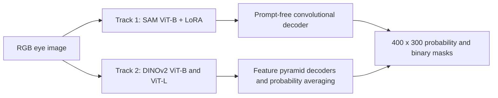

# Sclera Segmentation | SSBC 2026

**Prompt-free SAM-LoRA adaptation and DINOv2 Mean Teacher learning for sclera segmentation under full and limited supervision.**

[](https://github.com/AnantGp/ssbc-2026-sclera-segmentation/actions/workflows/checks.yml)

[Paper](https://lmi.fe.uni-lj.si/wp-content/uploads/2026/09/IJCB_SSBC_2026.pdf) · [Competition](https://sites.google.com/hyderabad.bits-pilani.ac.in/ssbc2026/home) · [Methods](docs/methods.md) · [Reproduction](docs/reproduction.md) · [Results and limitations](docs/results.md)

Research code from **Gourav Gupta and Anant Gupta, Arogya Pandit**, for the 2026 Sclera Segmentation Benchmarking Competition, held in conjunction with IEEE/IAPR IJCB 2026. Our entries are **SAM-LoRA** in Track 1 and **DINOv2 MT Ensemble** in Track 2, also called *DINOv2 Ensemble* in the results tables.

## The Problem

Sclera segmentation identifies the white region of the eye at pixel level. In ocular biometrics, inaccurate boundaries can include the iris, eyelids, skin, or reflections and compromise downstream analysis. Mobile capture, lighting changes, low image quality, and the difference between synthetic and real images make reliable segmentation difficult. Dense annotation is also expensive.

This project investigated two questions:

1. Can a general-purpose segmentation foundation model be adapted to sclera images with a frozen backbone and a small trainable component?
2. Can self-supervised visual representations and unlabelled eye images reduce dependence on pixel-level labels?

## Our Approach

### Track 1: SAM-LoRA

We adapt SAM's ViT-B image encoder with Low-Rank Adaptation (LoRA), freezing the original backbone weights. A lightweight convolutional decoder replaces SAM's prompt-based mask decoder, so inference needs an RGB eye image and no points, boxes, or text prompts.

- **Input:** RGB at 1024 x 1024; SAM pixel normalization inside the model.
- **Adaptation:** LoRA on the combined attention QKV projection, attention output projection, and MLP linear layers.
- **Decoder:** two transposed-convolution upsampling stages followed by convolutional refinement, producing a one-channel 256 x 256 logit map.
- **Supervision:** weighted binary cross-entropy and Dice loss.
- **Submission inference:** sigmoid probabilities, threshold 0.50, no test-time augmentation.

### Track 2: DINOv2 Mean Teacher Ensemble

We combine DINOv2 ViT-B/14 and ViT-L/14 segmenters, each with a feature pyramid decoder. During training, a student learns from the limited labelled set and from consistency with an exponential-moving-average teacher on unlabelled images.

- **Input:** RGB, resized and padded to 518 x 518, with ImageNet normalization.
- **Features:** four intermediate transformer blocks per backbone.
- **Training:** Dice + BCE on labelled images and confidence-filtered consistency loss on unlabelled images.
- **Adaptation:** frozen backbone weights with trainable LayerNorm and decoder parameters in the principal DINOv2 configurations.
- **Submission inference:** average probabilities across both models, three scales, and horizontal flips; threshold 0.50.



The full description, training settings, and source entry points are in [Methods](docs/methods.md).

## Official Results

The competition evaluated submissions on **MOBIUS**, **SMD+SLD**, and **SynMOBIUS**. Rankings use the harmonic mean of dataset F1 scores. The figures below are the official aggregate results in Tables 3 and 4 of the [public summary paper](https://lmi.fe.uni-lj.si/wp-content/uploads/2026/09/IJCB_SSBC_2026.pdf).

| Track | Entry | Rank | F1 | Precision | Recall | IoU | AUC |
| --- | --- | --- | --- | --- | --- | --- | --- |
| T1 | SAM-LoRA | 10 / 10 | 0.098 | 0.058 | 0.398 | 0.054 | 0.113 |
| T2 | DINOv2 Ensemble | 6 / 7 | 0.465 | 0.346 | 0.854 | 0.314 | 0.646 |

**Internal validation did not transfer to the official evaluation.** The project is released as a research record of the approach, implementation, and failure analysis. Historical validation values printed by the original scripts are not competition scores.

A source audit also found a Track 1 LoRA scaling mismatch and differences between validation and submission image geometry. Their contribution to the final scores has not been established by a controlled rerun. See [Results and limitations](docs/results.md) for the evidence and open questions.

## What Is Included

```text
.
├── README.md
├── CITATION.cff
├── references.bib
├── docs/
│   ├── methods.md              # Architecture, objectives, and design decisions
│   ├── reproduction.md         # Environment, datasets, checkpoints, and commands
│   ├── results.md              # Official results and unresolved implementation issues
│   └── provenance.md           # Source history, submission selection, and release scope
├── research/                  # Original training, evaluation, and experiment scripts
├── scripts/
│   ├── submission_utils.py    # Shared strict mask validation
│   ├── package_submission.py  # Build the correct flat submission ZIP
│   └── validate_submission.py # Validate every image and expected filename
├── tests/                     # Packaging and validation regression tests
└── .github/workflows/checks.yml
```

The original Python scripts are preserved in `research/`. The [experiment map](docs/methods.md#experiment-map) separates the final models from baselines and exploratory variants. Dataset images, ground-truth masks, checkpoints, submission archives, and the paper PDF are not redistributed here. Obtain datasets through the organizers and their licensing process.

## Quick Start

The packaging tools run on CPU and require only Pillow:

```bash
git clone https://github.com/AnantGp/ssbc-2026-sclera-segmentation.git
cd ssbc-2026-sclera-segmentation
python3 -m venv .venv
source .venv/bin/activate
python -m pip install -r requirements.txt
```

Package an existing set of predictions. `--source` must contain the three dataset folders directly; for a historical run it can point to `T1/Synthetic` or `T2/Synthetic`:

```bash
python scripts/package_submission.py \
  --source /path/to/T1/Synthetic \
  --test-dir /path/to/Evaluation \
  --output outputs/T1_SAM_LoRA.zip

python scripts/validate_submission.py \
  outputs/T1_SAM_LoRA.zip \
  --test-dir /path/to/Evaluation
```

The validator checks the ZIP layout, dataset counts, exact output filenames, PNG encoding, 400 x 300 size, grayscale mode, and binary values for **every mask**. It prints `Local validation passed` when all checks succeed. This is our release checker; it is independent of the organizer's checker and cannot measure segmentation accuracy.

The same commands apply to Track 2 with its source directory and an output name such as `T2_DINOv2_Ensemble.zip`. The output ZIP has no track or training-protocol wrapper:

```text
T1_SAM_LoRA.zip
├── MOBIUS/
│   ├── Predictions/*.png
│   └── Binarised/*.png
├── SMD+SLD/
│   ├── Predictions/*.png
│   └── Binarised/*.png
└── SynMOBIUS/
    ├── Predictions/*.png
    └── Binarised/*.png
```

For the complete evaluation set, each ZIP contains **17,598 PNGs**: two masks for each of the 8,799 images. Do not merge masks from multiple checkpoints into the same dataset folders.

Training and inference require the research dependencies, licensed datasets, and compatible checkpoints. The original code assumes CUDA and the historical `/home/jupyter/sclera` layout. Read [Reproduction](docs/reproduction.md) before running it, especially the warnings about the original submission script's extra directory layer and historical LoRA scaling.

## Paper and Attribution

**Label-Efficient Sclera Segmentation with Foundation Models: SSBC 2026**
M. Vitek, D. D. Premani, A. Das, and collaborators.
Proceedings of the IEEE/IAPR International Joint Conference on Biometrics (IJCB), 2026, pp. 1-13.

Gourav Gupta and Anant Gupta are co-authors of the joint competition paper. This repository contains the Arogya Pandit team's implementation; the comparison and competition organization are collaborative work by the paper's authors.

[Public paper](https://lmi.fe.uni-lj.si/wp-content/uploads/2026/09/IJCB_SSBC_2026.pdf) · [Organizer lab publication record](https://lmi.fe.uni-lj.si/en/research/publications/) · [BibTeX](references.bib) · [Software citation](CITATION.cff)

The organizer lab lists the paper as a proceedings article. No IEEE Xplore DOI is asserted here. SAM, DINOv2, LoRA, Mean Teacher, and FPN are credited in [references.bib](references.bib).

## Development and Reuse

Run the release checks with:

```bash
python -m unittest discover -s tests -v
```

The release tests exercise the new packaging tools using generated masks. They do not rerun the historical GPU experiments. See [LICENSE.md](LICENSE.md) for code and third-party licensing status, and [CONTRIBUTING.md](CONTRIBUTING.md) for useful ways to extend this research.
